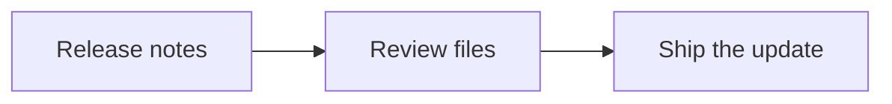

# Release checklist

Keep the notes, export and configuration together.

## Files in this folder

- [Configuration](settings.json)
- [Release export](releases.csv)

| File | What to inspect |
| --- | --- |
| settings.json | Nested configuration |
| releases.csv | Versions and channels |

## Next check

- [x] Read the release notes
- [ ] Check the exported records

This folder contains sample data for a Glim walkthrough.
